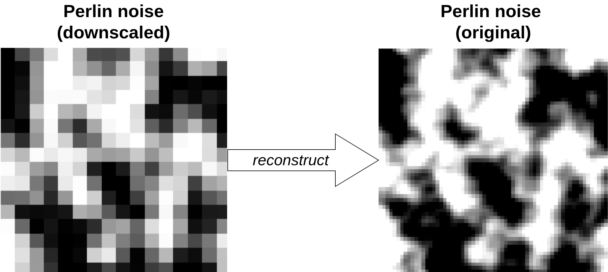

# GAN vs. Diffusion

A small experiment comparing a pix2pix GAN and a diffusion model on a simple super-resolution task.

## The problem

The task is to reconstruct a sharp 64 × 64 image from a blocky, low-resolution version of it. The data is artificial Perlin noise: the input is the same image with every 4 × 4 block of pixels replaced by its average.



## Files

- `main.py`: runs the experiment (data, training, evaluation, plots). Settings are at the top of the file.
- `gan.py`: pix2pix generator, discriminator and training step.
- `diffusion.py`: diffusion U-Net, noise schedule, sampling and training step.
- `data_generation.py`: creates the Perlin-noise image pairs.
- `utils.py`: helpers for evaluation, timing, memory measurement and plots.

## Setup and usage

```bash
pip install torch numpy matplotlib pillow noise
python main.py
```

The first run generates the data and saves it to `perlin_data.npz`. Afterwards you can set `GEN_SAMPLES = False` in `main.py` to reuse it.

## Output

- `gan_training.gif` and `diffusion_training.gif`: the same test image during training
- `gan_last_generation.png` and `diffusion_last_generation.png`: the result after the last epoch
- `rmse_curves.png`: test RMSE during training for both models
- `results.json`: RMSE history, training time, memory and inference time

A summary is also printed to the console at the end.